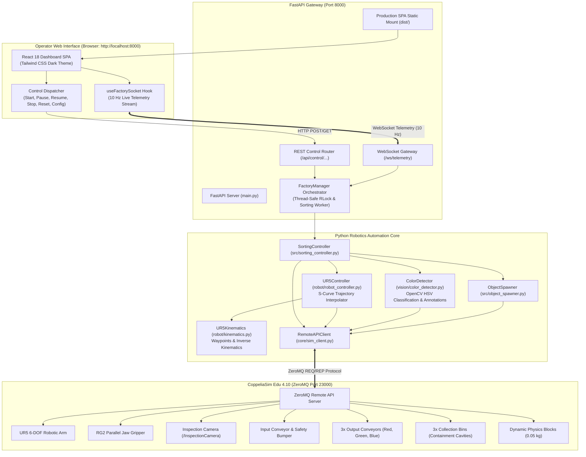

# Intelligent Industrial Object Sorting System

[](https://www.python.org/)
[](https://www.coppeliarobotics.com/)
[](https://fastapi.tiangolo.com/)
[](https://react.dev/)
[](https://zeromq.org/)
[](LICENSE)

An end-to-end autonomous industrial sorting cell simulating modern robotic logistics and recycling facilities. Features a **Universal Robots UR5** 6-DOF manipulator, an **OnRobot RG2** mechanical parallel gripper, overhead **OpenCV HSV computer vision**, dynamic infeed queuing, 3D physical bin containment verification, and a modern real-time **React + FastAPI** supervisory monitoring dashboard.

> 📖 **Looking to fork or contribute?**  
> Check out the complete step-by-step [**Contributor & Setup Guide (CONTRIBUTING.md)**](CONTRIBUTING.md) for environment configuration, remote git tracking, and local development.

---

## Table of Contents

1. [Project Overview & Problem Statement](#project-overview--problem-statement)
2. [Key Features & Technology Stack](#key-features--technology-stack)
3. [System Architecture](#system-architecture)
4. [Project Directory Structure](#project-directory-structure)
5. [Prerequisites & Installation](#prerequisites--installation)
6. [Step-by-Step Startup Guide](#step-by-step-startup-guide)
7. [Dashboard Controls & REST/WebSocket API Reference](#dashboard-controls--restwebsocket-api-reference)
8. [Test Suite Execution & Real Verified Results](#test-suite-execution--real-verified-results)
9. [Physical Factory Layout Reference](#physical-factory-layout-reference)
10. [Troubleshooting Guide](#troubleshooting-guide)
11. [Current Limitations & Future Roadmap](#current-limitations--future-roadmap)
12. [Capturing Screenshots & Demo Recording](#capturing-screenshots--demo-recording)

---

## Project Overview & Problem Statement

Modern distribution, automated manufacturing, and high-speed recycling facilities require reliable sorting of heterogeneous parts under strict cycle-time constraints without mechanical jams, lost inventory, or collision hazards.

This project delivers a fully autonomous cyber-physical robotic sorting system addressing these core challenges:
- **Autonomous Vision-Guided Routing**: Inspects arriving dynamic objects using an overhead camera sensor, classifies primary colors (Red, Green, Blue) using robust HSV color-space processing, and rejects ambiguous or contaminated objects.
- **Precision Collision-Free Pick-and-Place**: Solves kinematics using collision-free transit corridors that tuck high above conveyor rails and pedestals.
- **Dynamic Infeed Queuing & Flow Control**: Dynamically spawns physics-enabled cuboids at the inlet, prevents conveyor pileups with spatial clearance checks, halts the infeed during pickup, and resumes automatically when clear.
- **Physical 3D Cavity Containment**: Proves that every sorted item actually lands and remains secured inside the matching collection bin.
- **Real-Time Supervisory Telemetry**: Provides industrial operators with real-time KPI metrics, live inspection camera frames with detection bounding boxes, timestamped activity audit trails, and remote factory controls (Start, Safe Pause, Resume, Safe Stop, Reset, Configure).

---

## Key Features & Technology Stack

### Core Technologies
- **Physics Simulation Engine**: [CoppeliaSim Edu 4.10.0](https://www.coppeliarobotics.com/) (Bullet 2.78 / Newton physics solver)
- **Programming Language**: Python 3.13.5 (Compatible with Python 3.10+)
- **IPC Protocol**: CoppeliaSim ZeroMQ Remote API (`coppeliasim-zmqremoteapi-client` via cbor2 / pyzmq)
- **Computer Vision**: OpenCV (`cv2`) for HSV colorspace segmentation, morphological filtering, and confidence metrics
- **Backend API Gateway**: FastAPI, Uvicorn (ASGI server), WebSockets, Pydantic v2
- **Frontend Dashboard**: React 18, Vite 8, Tailwind CSS (Industrial Slate/Cyan theme), Recharts, Lucide Icons

### Project Highlights
- **100% Physics-Verified Pick-and-Place**: Genuine mechanical grasping using OnRobot RG2 finger joint actuation.
- **High-Elbow Collision-Free Geometry**: Pre-calculated joint configurations maintain an overhead transit plane ($Z=0.88\,\text{m}$, elbow $Z=0.89\,\text{m}$) clear of camera stands, conveyors, and bin rims.
- **Zero-Mock Dashboard**: Dashboard telemetry and video streaming are tied 100% to active simulation objects; no simulated or fabricated data.
- **Graceful Lifecycle Management**: Safe pause and stop routines dock the arm at Home pose without dropping objects mid-air.

---

## System Architecture



---

## Project Directory Structure

```text
d:/industrial-robot-sorter/
├── config/
│   ├── __init__.py
│   └── settings.py                     # Centralized geometry, coordinates, and environment variable fallbacks
├── core/
│   ├── __init__.py
│   └── sim_client.py                   # ZeroMQ Remote API client initialization
├── dashboard/
│   ├── backend/
│   │   ├── __init__.py
│   │   ├── factory_manager.py          # Thread-safe factory orchestrator & ZeroMQ command serializer
│   │   ├── main.py                     # FastAPI server, REST routes, and WebSocket 10Hz streaming
│   │   └── models.py                   # Pydantic schemas (FactoryState, TelemetryPacket, ConfigPayload)
│   └── frontend/
│       ├── dist/                       # Pre-compiled production SPA bundle (served directly by FastAPI)
│       ├── src/
│       │   ├── components/             # Topbar, Sidebar, StatusCards, LiveCamera, SortingAnalytics, ActivityLog, SettingsModal
│       │   ├── hooks/                  # useFactorySocket.js (dynamic WebSocket/REST protocol resolution)
│       │   ├── App.jsx                 # Master responsive factory dashboard layout
│       │   └── index.css               # Tailored industrial dark design system
│       ├── package.json
│       ├── tailwind.config.js
│       └── vite.config.js
├── robot/
│   ├── __init__.py
│   ├── kinematics.py                   # Joint coordinates for high-elbow collision-free waypoints
│   ├── robot_controller.py             # UR5 trajectory interpolation and RG2 gripper control
│   └── test_robot_motion.py            # Phase 3 motion & physics grasp test suite
├── scene/
│   ├── __init__.py
│   ├── inspect_scene.py                # Inspects and prints scene handles and types
│   ├── build_scene.py                  # Idempotent scene constructor
│   └── validate_scene.py               # Scene validation suite (handles, vision, gripper, conveyor motion, bin containment)
├── scenes/
│   └── sorting_factory.ttt             # Binary CoppeliaSim simulation scene (1.6 MB)
├── src/
│   ├── __init__.py
│   ├── object_spawner.py               # Dynamic object spawner & lifecycle state machine
│   └── sorting_controller.py           # Automated sorting orchestrator & continuous automation loop
├── tests/
│   ├── __init__.py
│   ├── test_phase4_sorting.py          # Phase 4 camera acquisition, RGB classification & multi-block test
│   ├── test_phase5_continuous_sorting.py # Phase 5 continuous 6-block sorting test
│   ├── test_phase6_reliability.py      # Phase 6 fault recovery, 12-block stress test & multi-trial stability
│   └── test_phase7_dashboard.py        # Phase 7 REST API, WebSocket stream & factory control test
├── vision/
│   ├── __init__.py
│   ├── color_detector.py               # OpenCV HSV color detector with confidence scoring & annotations
│   └── test_color_detector.py          # Vision sensor unit tests
├── .gitignore                          # Excludes caches, venv, secrets, logs, node_modules; whitelists scene & dist
├── CONTRIBUTING.md                     # Contributor and developer fork guide
├── requirements.txt                    # Python project dependencies
├── test_connection.py                  # ZeroMQ Remote API connectivity check
└── README.md
```

---

## Prerequisites & Installation

### 1. System Requirements
- **OS**: Windows 10/11, Linux (Ubuntu 20.04+), or macOS
- **Python**: Python 3.10 to 3.13 (64-bit)
- **CoppeliaSim**: [CoppeliaSim Edu 4.10.0](https://www.coppeliarobotics.com/) (or 4.6.0+)

### 2. Install Python Dependencies
Open your terminal in the project root:

```powershell
pip install -r requirements.txt
```

*Contents of `requirements.txt`:*
- `coppeliasim-zmqremoteapi-client>=2.0.4`
- `cbor2>=5.6.2`
- `numpy>=2.0.0`
- `opencv-python>=4.8.0`
- `fastapi>=0.115.0`
- `uvicorn[standard]>=0.30.0`
- `websockets>=13.0`
- `pydantic>=2.8.0`
- `pytest>=8.0.0`

---

## Step-by-Step Startup Guide

Follow this exact sequence to launch and verify the complete system:

```text
Step 1: Install Dependencies  -->  pip install -r requirements.txt
Step 2: Launch CoppeliaSim    -->  Open scenes/sorting_factory.ttt in GUI mode
Step 3: Verify ZeroMQ Port    -->  python test_connection.py (Port 23000)
Step 4: Start FastAPI Server  -->  python -m uvicorn dashboard.backend.main:app --port 8000
Step 5: Access Web Dashboard  -->  http://localhost:8000
Step 6: Supervise Sorting     -->  Click [Start] on the dashboard topbar
```

### Detailed Commands

#### 1. Open CoppeliaSim with Factory Scene
Launch CoppeliaSim in **GUI mode** (do not use `-h` headless mode, as Qt-based conveyor scripts require GUI rendering):

```powershell
# Windows
& "C:\Program Files\CoppeliaRobotics\CoppeliaSimEdu\coppeliaSim.exe" "D:\industrial-robot-sorter\scenes\sorting_factory.ttt"

# Linux
~/CoppeliaSim/coppeliaSim.sh scenes/sorting_factory.ttt
```

#### 2. Confirm ZeroMQ Port & Communication
Verify that Python can communicate with CoppeliaSim:

```powershell
python test_connection.py
```
*Expected output: `[SUCCESS] Successfully connected to CoppeliaSim! Version: 4.10.0`*

#### 3. Start the Dashboard Backend
From the project root:

```powershell
python -m uvicorn dashboard.backend.main:app --host 0.0.0.0 --port 8000
```
The server will:
- Connect to the CoppeliaSim ZeroMQ Remote API on port `23000`.
- Initialize `SortingController` and `ColorDetector`.
- Serve the pre-built React dashboard SPA directly from `dashboard/frontend/dist`.
- Expose REST API routes and the `/ws/telemetry` WebSocket gateway.

#### 4. Open the Dashboard
Open your browser and navigate to:
```text
http://localhost:8000
```

#### 5. Operate the Factory Cell
- **Click `Start`**: Starts continuous dynamic feeding, camera inspection, robotic pick-and-place, and bin sorting.
- **Click `Pause`**: Requests a safe pause at the next operation boundary (does not drop in-transit blocks).
- **Click `Resume`**: Resumes sorting from the paused state.
- **Click `Stop`**: Initiates safe stop; the topbar updates to `STOPPING SAFELY...`, the robot finishes in-flight actions, and docks safely at `Home` before reporting `CELL STOPPED`.
- **Click `Reset`**: Reloads the simulation scene to its clean baseline and resets all telemetry counters.
- **Click `Configure`** (Settings gear in sidebar): Adjusts target object counts, infeed/discharge conveyor velocities, and color distributions.

---

## Dashboard Controls & REST/WebSocket API Reference

### REST Endpoints

| Method | Endpoint | Description | Sample Request / Response |
| :--- | :--- | :--- | :--- |
| `GET` | `/` | Serves production React SPA | HTML index page |
| `GET` | `/api/health` | Health check & simulator connection status | `{"status": "ok", "connected": true}` |
| `GET` | `/api/status` | Current factory KPIs & operational statistics | Returns `SystemStats` model |
| `GET` | `/api/telemetry` | Consolidated telemetry snapshot (stats, vision, logs) | Returns `TelemetryPacket` model |
| `GET` | `/api/camera/frame` | Live annotated JPEG frame from `/InspectionCamera` | `image/jpeg` binary stream |
| `GET` | `/api/logs` | Full chronological activity log entries | `[ActivityLogEntry, ...]` |
| `POST`| `/api/control/start` | Starts continuous automated sorting | `{"success": true, "message": "..."}` |
| `POST`| `/api/control/pause` | Safe boundary pause request | `{"success": true, "message": "..."}` |
| `POST`| `/api/control/resume`| Resumes sorting after safe pause | `{"success": true, "message": "..."}` |
| `POST`| `/api/control/stop` | Commands safe stop & Home pose docking | `{"success": true, "message": "..."}` |
| `POST`| `/api/control/reset` | Resets scene and clears statistics | `{"success": true, "message": "..."}` |
| `POST`| `/api/control/config`| Updates runtime sorting configuration | Body: `ConfigPayload` |

### WebSocket Gateway

| Protocol | URL | Frequency | Description |
| :--- | :--- | :--- | :--- |
| `WS` | `ws://localhost:8000/ws/telemetry` | **10 Hz** (~100 ms) | Streams consolidated JSON packets containing live KPIs, color breakdown, detection metadata, Base64 JPEG frame, and recent activity logs. |

---

## Test Suite Execution & Real Verified Results

All test suites were executed against the active CoppeliaSim Edu 4.10.0 instance. Every metric below is derived from actual test runs:

```powershell
# Run all verification suites in sequence:
python test_connection.py
python scene/validate_scene.py
python robot/test_robot_motion.py
python vision/test_color_detector.py
python tests/test_phase4_sorting.py
python tests/test_phase5_continuous_sorting.py
python tests/test_phase6_reliability.py
python tests/test_phase7_dashboard.py
```

### Comprehensive Verification Summary Table

| Suite | File | Verified Outcomes | Real Status |
| :--- | :--- | :--- | :---: |
| **Phase 1: Connection** | `test_connection.py` | ZMQ Remote API connected on port 23000; sim version raw: 41000 | **PASSED** ✅ |
| **Phase 2: Scene Validation** | `scene/validate_scene.py` | 21/21 object handles verified; camera 128x128px; RG2 signals; conveyor displacement +0.100m; Red bin containment | **PASSED** ✅ |
| **Phase 3: Motion & Grasp** | `robot/test_robot_motion.py` | 8/8 kinematic poses max joint error < 0.001°; RG2 mechanical spread 0.0426 rad / close -0.0024 rad; physical lift Z=0.843m; Red bin containment | **PASSED** ✅ |
| **Phase 4: RGB Detection** | `vision/test_color_detector.py` | Empty belt 0 false positives; Red (98.5%), Green (98.5%), Blue (98.5%) classification accuracy | **PASSED** ✅ |
| **Phase 4: Multi-Block Sort** | `tests/test_phase4_sorting.py` | Camera check; static detection; single Red, Green, Blue cycles; 3/3 sequential multi-block run | **PASSED** ✅ |
| **Phase 5: Continuous Feed**| `tests/test_phase5_continuous_sorting.py`| Spawner unique IDs; inlet flow clearance; 6/6 continuous sort (2R, 2G, 2B) in 54.6s; 100% bin containment; full lifecycle verified | **PASSED** ✅ |
| **Phase 6: Fault Recovery** | `tests/test_phase6_reliability.py` | 1.1 Empty queue timeout, 1.2 Blocked inlet protection, 1.3 Max spawn cap, 1.4 Ambiguous color reject, 1.5 Missing conveyor guard, 1.6 Grasp slippage recovery, 1.7 Duplicate processing prevention | **PASSED** ✅ |
| **Phase 6: Stress Run** | `tests/test_phase6_reliability.py` | **12/12 blocks sorted into matching bins (4R, 4G, 4B) in 114.96s** (9.58s/block avg, 6.26 bpm); 100% 3D cavity containment | **PASSED** ✅ |
| **Phase 6: Multi-Trial** | `tests/test_phase6_reliability.py` | Trial 1: 6/6 sorted in 48.89s; Trial 2: 6/6 sorted in 52.39s; 0 memory leak; 0 stale handles | **PASSED** ✅ |
| **Phase 7: Dashboard API** | `tests/test_phase7_dashboard.py` | 5 REST endpoints verified; 10Hz WebSocket verified; config update applied; Start -> Safe Pause -> Resume -> Safe Stop -> Reset sequence passed | **PASSED** ✅ |

---

## Physical Factory Layout Reference

| Component | CoppeliaSim Alias | Position `[X, Y, Z]` (m) | Purpose / Details |
| :--- | :--- | :--- | :--- |
| **Robot Pedestal** | `/RobotPedestal` | `[0.0, 0.0, 0.20]` | Structural steel mounting pedestal ($0.35 \times 0.35 \times 0.40\,\text{m}$) |
| **UR5 Robotic Arm** | `/UR5` | `[0.0, 0.0, 0.40]` | 6-DOF industrial manipulator mounted at $Z=0.40\,\text{m}$ |
| **UR5 Joints** | `/UR5/UR5_joint1..6` | Varied | Dynamically controlled via `UR5Controller` |
| **RG2 Gripper** | `/UR5/connection/RG2` | End-effector | Parallel jaw mechanical gripper (`signal.RG2_open`) |
| **Input Conveyor** | `/InputConveyor` | `[-0.85, 0.0, 0.70]` | Feeds blocks towards the robot ($V=0.15\,\text{m/s}$) |
| **Input End Bumper** | `/InputEndBumper` | `[-0.34, 0.0, 0.73]` | Mechanical stop aligning blocks under camera |
| **Inspection Camera**| `/InspectionCamera` | `[-0.40, 0.0, 1.15]` | Overhead inspection sensor looking down at pickup stop |
| **Output Conveyor (Red)** | `/OutputConveyorRed` | `[0.0, 0.85, 0.70]` | Discharges North ($+Y$) towards Red Bin |
| **Output Conveyor (Green)**| `/OutputConveyorGreen` | `[0.85, 0.0, 0.70]` | Discharges East ($+X$) towards Green Bin |
| **Output Conveyor (Blue)** | `/OutputConveyorBlue` | `[0.0, -0.85, 0.70]` | Discharges South ($-Y$) towards Blue Bin |
| **Red Collection Bin** | `/RedCollectionBin` | `[0.0, 1.52, 0.0]` | Open cavity ($0.26 \times 0.26\,\text{m}$) receiving Red blocks |
| **Green Collection Bin**| `/GreenCollectionBin` | `[1.52, 0.0, 0.0]` | Open cavity ($0.26 \times 0.26\,\text{m}$) receiving Green blocks |
| **Blue Collection Bin** | `/BlueCollectionBin` | `[0.0, -1.52, 0.0]` | Open cavity ($0.26 \times 0.26\,\text{m}$) receiving Blue blocks |

---

## Troubleshooting Guide

### 1. Connection Timeout or `SYN_SENT` on Port 23000
- **Cause**: CoppeliaSim is not running, or the ZeroMQ Remote API plugin did not start.
- **Fix**: Launch CoppeliaSim, open `scenes/sorting_factory.ttt`, and check CoppeliaSim's console for `[ZeroMQ Remote API server: started listening on port 23000]`. If running on a non-default port or remote machine, set the environment variables:
  ```powershell
  $env:ZMQ_HOST = "localhost"
  $env:ZMQ_PORT = "23000"
  ```

### 2. Conveyor Motion Fails or `[simUI:error]` in Console
- **Cause**: CoppeliaSim was started in headless mode (`-h`). The generic conveyor models utilize Qt-based customization scripts (`models\efficientconveyor_customization-3.lua`) that require GUI window context.
- **Fix**: Always start CoppeliaSim in normal GUI mode.

### 3. Missing Scene Object Handles
- **Cause**: The scene file was modified, objects were renamed, or an empty scene was loaded.
- **Fix**: Run `python scene/validate_scene.py`. It inspects all 21 object handles and verifies geometry against `config/settings.py`.

### 4. Camera Frame Appears Black or Truncated
- **Cause**: Simulation is stopped or the vision sensor handle was corrupted.
- **Fix**: Click `Reset` on the dashboard or execute `sim.startSimulation()`. The vision pipeline handles byte buffer inversion and BGR format conversion automatically.

### 5. Frontend Build or Port 5173 Proxy Errors
- **Cause**: The pre-built SPA bundle in `dashboard/frontend/dist` is already served on port 8000 by FastAPI. Running `npm run dev` is only needed when editing JSX/CSS components.
- **Fix**: Simply open `http://localhost:8000`. If editing the frontend, ensure Vite's proxy targets port 8000.

---

## Current Limitations & Future Roadmap

### Known Limitations
1. **Single-Socket ZMQ Remote API Serialization**: The ZeroMQ Remote API uses synchronous REQ/REP transactions. Concurrent socket calls across multiple threads will corrupt message streams. `FactoryManager` uses `threading.RLock()` to ensure serialized simulation interaction.
2. **Single Inspection Point**: Classification occurs strictly at the infeed bumper station. Moving objects are not classified in-flight along the belt.
3. **Single-Arm Peak Throughput**: A single 6-DOF UR5 arm handling all trajectories caps peak continuous throughput at $\approx 6.5\,\text{blocks/min}$ ($\approx 9.5\,\text{s/cycle}$).
4. **Bin Capacity**: Collection bins have an internal volume of $0.26 \times 0.26 \times 0.24\,\text{m}$. Sorting more than $\approx 16$ objects of the same color may cause stacking near the conveyor discharge lip.

### Future Roadmap
- [ ] **Dual-Arm Sorting Cell**: Implement a secondary UR5 or SCARA robot to handle alternating pick cycles, increasing throughput to $> 12\,\text{blocks/min}$.
- [ ] **Dynamic Tracking & Conveyor Synchronized Picking**: Use linear conveyor tracking encoders to pick blocks while the belt is moving without stopping at the bumper.
- [ ] **YOLOv8 Object Detection**: Replace HSV color segmentation with a deep learning bounding-box model to recognize complex shapes, barcodes, and defective parts.
- [ ] **Automated Automated Guided Vehicle (AGV) Discharge**: Dispatch mobile robots to retrieve full collection bins and transport them to a warehouse staging area.

---

## Capturing Screenshots & Demo Recording

To generate portfolio-grade demonstration media:

### 1. High-Resolution Simulation Video
1. Open `scenes/sorting_factory.ttt` in CoppeliaSim.
2. In CoppeliaSim, navigate to **Tools > Video recorder**.
3. Select your output format (`MP4` or `AVI`) and set resolution to `1920x1080` at `30 FPS`.
4. Run continuous sorting from the dashboard at `http://localhost:8000`.
5. Stop the video recorder when the run finishes.

### 2. Live Dashboard Screen Capture
1. Start the backend: `python -m uvicorn dashboard.backend.main:app --port 8000`.
2. Open `http://localhost:8000` in Google Chrome or Microsoft Edge.
3. Use **OBS Studio** or Windows Game Bar (`Win + G`) to capture side-by-side windows:
   - Left half: CoppeliaSim 3D simulation showing UR5 motion and bin discharge.
   - Right half: Web dashboard showing real-time camera overlays, 10Hz KPI graphs, and activity logs.

---

## License & Authors

- **Author**: Tanmay Kad
- **Repository**: [https://github.com/Tanmay-Kad/intelligent-industrial-robot-sorter](https://github.com/Tanmay-Kad/intelligent-industrial-robot-sorter)
- **License**: MIT License. See [LICENSE](LICENSE) for details.
